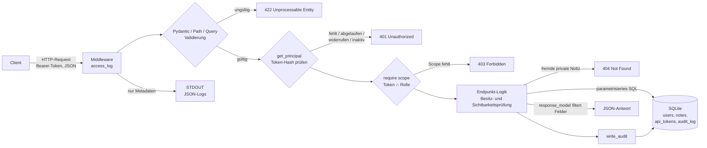

# Datenfluss der Notizen-API (Feld 2: Code Security)

Dieses Dokument beschreibt, welchen Weg Daten durch die Anwendung nehmen und an welcher Stelle sie geprüft werden. Der gesamte Code liegt in [`web/app.py`](../web/app.py) und [`web/logging_setup.py`](../web/logging_setup.py).

## Übersicht

## Schritte im Detail

| # | Station | Was passiert | Code |
|---|---|---|---|
| 1 | **Middleware** `access_log` | Misst die Dauer und protokolliert nur Methode, Pfad, Status und Dauer. Request-Bodies, Tokens und Passwörter werden nie geloggt. | `access_log`, `logging_setup.log_event` |
| 2 | **Eingabevalidierung (Fail Fast)** | Bevor eine Zeile Endpunktcode läuft, prüft FastAPI/Pydantic Typ, Länge, Muster und Wertebereich. Verstöße enden sofort mit **422**, es entsteht kein Seiteneffekt in der Datenbank. | `LoginIn`, `NoteIn`, `ApiTokenIn`, `UserCreate`, `Path(ge=1)`, `Query(le=100)` |
| 3 | **Authentifizierung** | Das Bearer-Token wird mit SHA-256 gehasht und mit `api_tokens.token_hash` verglichen. Der Klartext wird nie gespeichert. Abgelaufene, widerrufene Tokens und inaktive Nutzer werden mit **401** abgelehnt. | `get_principal`, `hash_token` |
| 4 | **Autorisierung** | Effektive Rechte = Scopes des Tokens ∩ Scopes der *aktuellen* Rolle. Fehlt der benötigte Scope, kommt **403**. | `require`, `ROLE_SCOPES` |
| 5 | **Objektzugriff** | Notizen werden nur geliefert, wenn der Aufrufer Besitzer oder Admin ist oder die Notiz `team` ist. Sonst kommt **404**, damit die Existenz fremder Notizen nicht erkennbar ist. | `load_note`, `ensure_can_modify` |
| 6 | **Datenbank** | Alle Abfragen sind parametrisiert (`?`). `LIKE`-Muster werden escaped. Fremdschlüssel sind aktiv. Nicht committete Änderungen werden beim Schließen verworfen. | `connect`, `get_db`, `escape_like` |
| 7 | **Audit-Log** | Sicherheitsrelevante Vorgänge werden in `audit_log` geschrieben, auch fehlgeschlagene Logins: Login/Logout, Token anlegen/widerrufen, Nutzer- und Rollenänderungen, Löschen. | `write_audit` |
| 8 | **Antwort** | `response_model` legt fest, welche Felder herausgehen. Passwort- und Token-Hashes verlassen die API nie. Ein neues API-Token wird genau einmal im Klartext ausgegeben. | `NoteOut`, `UserOut`, `ApiTokenCreated` |

## Schutzbedürftige Daten

| Datum | Eingang | Speicherung | Ausgang |
|---|---|---|---|
| Passwort | `POST /auth/login`, `POST /admin/users` | nur als scrypt-Hash mit zufälligem Salt | nie |
| API-Token | `Authorization: Bearer …` | nur als SHA-256-Hash | einmalig bei der Erstellung |
| Notizinhalt | `POST/PUT /notes` | Klartext in `notes` | nur an Berechtigte (Schritt 5) |
| Audit-Einträge | intern | `audit_log` | nur mit Scope `admin` |

## Login-Ablauf

1. `LoginIn` prüft die Längen (Benutzername ≤ 64, Passwort ≤ 128 Zeichen). Das verhindert unter anderem DoS durch riesige Passwörter beim scrypt-Hashing.
2. Existiert der Benutzer nicht, wird gegen `DUMMY_HASH` geprüft. Die Antwortzeit verrät deshalb nicht, ob ein Konto existiert.
3. Bei einem Fehler kommt eine einheitliche **401**-Meldung, und `auth.login_failed` wird ins Audit-Log geschrieben.
4. Bei Erfolg wird ein Token mit 256 Bit Zufall und Präfix `nt_` erzeugt. Es ist 8 Stunden gültig und gehasht gespeichert.

## Sichere Defaults und Fehlerbehandlung

- **Admin-Passwort:** Fehlt `ADMIN_PASSWORD`, wird ein Zufallspasswort erzeugt, statt ein Standardpasswort zu setzen.
- **Token-Laufzeit:** Tokens laufen immer ab. Login-Tokens gelten 8 Stunden, selbst erstellte Tokens höchstens `MAX_TOKEN_DAYS` = 90 Tage.
- **Rechte:** Ein Token kann nie mehr Rechte haben als die aktuelle Rolle. Eine Herabstufung wirkt sofort.
- **Fehlerantworten:** Sie verraten keine Interna, etwa 404 statt 403 bei fremden Notizen oder eine einheitliche Login-Fehlermeldung.
- **Health-Check:** `/health` fängt `sqlite3.Error` explizit ab und liefert **503** statt eines Stacktraces.
- **Unerwartete DB-Zustände:** Ein fehlendes `lastrowid` wird z. B. explizit mit 500 behandelt, statt `None` weiterzureichen.
