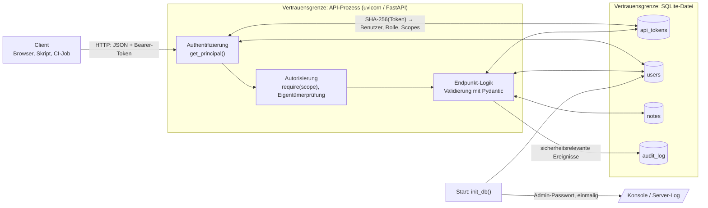

# Notizen-API

Eine kleine REST-API (Python, FastAPI, SQLite) zur Verwaltung von Notizen mit Benutzerkonten, drei Rollen, persönlichen API-Tokens mit eingeschränkten Rechten und einem Audit-Log. Der gesamte Code steckt in `app.py` (rund 600 Zeilen inklusive Kommentaren), damit sich jeder Datenfluss von der HTTP-Anfrage bis zur Tabelle verfolgen lässt. Das macht die API auch als Grundlage für eine Bedrohungsmodellierung (z. B. STRIDE) oder einen Penetrationstest geeignet.

## Start

Voraussetzung ist Python 3.10 oder neuer.

```bash
python -m venv .venv && source .venv/bin/activate
pip install -r requirements.txt
ADMIN_PASSWORD='bitte-ein-langes-passwort' uvicorn app:app --reload
```

Die interaktive Dokumentation liegt unter http://127.0.0.1:8000/docs. Beim ersten Start wird das Konto `admin` angelegt; ohne `ADMIN_PASSWORD` wird ein Zufallspasswort erzeugt und einmalig auf der Konsole ausgegeben. Der Speicherort der Datenbank lässt sich mit `NOTES_DB` ändern (Standard: `notes.db`). Die Tests laufen mit `pytest -q`.

## Rollen und Scopes

| Rolle  | Scopes                | Darf                                                                |
|--------|-----------------------|---------------------------------------------------------------------|
| viewer | `read`                | eigene und Team-Notizen lesen                                       |
| editor | `read`, `write`       | zusätzlich Notizen anlegen sowie eigene ändern und löschen          |
| admin  | `read`, `write`, `admin` | alle Notizen, Benutzer- und Rollenverwaltung, Audit-Log          |

Jedes Token trägt eigene Scopes. Die effektiven Rechte einer Anfrage sind die Schnittmenge aus den Scopes des Tokens und den Scopes der *aktuellen* Rolle des Benutzers. Daraus folgen zwei Eigenschaften: Eine Herabstufung wirkt sofort auf alle vorhandenen Tokens, und ein Token kann beim Erstellen neuer Tokens nie mehr Rechte weitergeben, als es selbst besitzt.

## Endpunkte

| Methode | Pfad                      | Parameter                                        | Recht                          | Schutzbedürftig |
|---------|---------------------------|--------------------------------------------------|--------------------------------|:---:|
| GET     | `/health`                 | –                                                | –                              |     |
| POST    | `/auth/login`             | Body: `username`, `password`                     | –                              | ✔ |
| POST    | `/auth/logout`            | –                                                | angemeldet                     |     |
| GET     | `/me`                     | –                                                | angemeldet                     |     |
| GET     | `/notes`                  | Query: `q`, `visibility`, `owner`, `limit`, `offset` | `read`                     |     |
| POST    | `/notes`                  | Body: `title`, `body`, `visibility`              | `write`                        |     |
| GET     | `/notes/{note_id}`        | Pfad                                             | `read`                         |     |
| PUT     | `/notes/{note_id}`        | Pfad, Body wie POST                              | `write`, Eigentümer oder Admin |     |
| DELETE  | `/notes/{note_id}`        | Pfad                                             | `write`, Eigentümer oder Admin | ✔ |
| GET     | `/tokens`                 | Query: `include_revoked`                         | angemeldet                     |     |
| POST    | `/tokens`                 | Body: `name`, `scopes`, `valid_days` (1–90)      | angemeldet                     | ✔ |
| DELETE  | `/tokens/{token_id}`      | Pfad                                             | eigene Tokens; Admin alle      | ✔ |
| GET     | `/admin/users`            | Query: `role`, `active`                          | `admin`                        |     |
| POST    | `/admin/users`            | Body: `username`, `password`, `role`             | `admin`                        | ✔ |
| PATCH   | `/admin/users/{user_id}`  | Pfad, Body: `role`, `active`                     | `admin`                        | ✔ |
| GET     | `/admin/audit`            | Query: `action` (Präfix), `actor_id`, `limit`    | `admin`                        | ✔ |

## Datenflüsse



**Anmeldung.** Benutzername und Passwort gehen an `/auth/login`. Das Passwort wird gegen einen scrypt-Hash mit zufälligem Salt geprüft; existiert der Benutzer nicht, wird gegen einen Dummy-Hash geprüft, damit die Antwortzeit nicht verrät, ob ein Konto existiert. Bei Erfolg entsteht ein Token aus 256 Bit Zufall mit dem Präfix `nt_`. In der Datenbank landet nur dessen SHA-256-Hash, der Klartext geht genau einmal an den Client zurück. Erfolg und Fehlschlag werden mit IP-Adresse im Audit-Log festgehalten.

**Authentifizierte Anfrage.** Der Header `Authorization: Bearer <token>` wird gehasht und über einen Join auf `api_tokens` und `users` aufgelöst. Abgelehnt wird mit einheitlich 401, wenn das Token unbekannt, widerrufen oder abgelaufen ist oder das Konto deaktiviert wurde. Andernfalls wird `last_used_at` aktualisiert und ein `Principal` mit den effektiven Scopes an den Endpunkt übergeben.

**Notizen lesen und suchen.** Die Sichtbarkeitsregel (eigene oder `team`, Admins alles) steckt direkt in der SQL-Abfrage, sodass Filter und Paginierung nie auf fremden privaten Daten arbeiten. Alle Parameter werden gebunden übergeben; der Suchbegriff wird zusätzlich für `LIKE` maskiert, damit `%` und `_` wörtlich gesucht werden. Eine fremde private Notiz liefert 404 statt 403, damit ihre Existenz nicht erkennbar ist.

**API-Token erstellen.** Die angeforderten Scopes müssen eine Teilmenge der effektiven Scopes des aufrufenden Tokens sein, sonst gibt es 403. Laufzeit höchstens 90 Tage. Der Klartext erscheint nur in dieser einen Antwort; `GET /tokens` zeigt danach nur noch Präfix und Metadaten.

**Rollen ändern und Konten deaktivieren.** Nur mit Scope `admin`. Der letzte aktive Admin kann weder herabgestuft noch deaktiviert werden (409). Eine Deaktivierung widerruft sofort alle Tokens des Kontos. Alter und neuer Zustand landen im Audit-Log.

## Bewusste Vereinfachungen als Ansatzpunkte für die Analyse

Die API ist sorgfältig, aber nicht produktionsreif gebaut. Folgende Punkte sind absichtlich offen geblieben und eignen sich als Diskussionsgrundlage: Es gibt keine Begrenzung von Login-Versuchen und keine Kontosperre, sodass Brute-Force nur durch die Kosten von scrypt gebremst wird. Die API spricht selbst kein TLS und braucht dafür einen Reverse Proxy; hinter einem Proxy würde zudem die protokollierte IP die des Proxys sein. Audit-Log und Nutzdaten liegen in derselben unverschlüsselten SQLite-Datei, wer Dateizugriff hat, kann also Notizen lesen und Protokolleinträge verändern (Nichtabstreitbarkeit). Das Bootstrap-Passwort erscheint im Server-Log. Abgelaufene Login-Tokens werden nie aufgeräumt, und jede Anfrage schreibt `last_used_at`, was unter Last zum Engpass werden kann. Es fehlen Endpunkte zum Ändern des eigenen Passworts und zum Löschen von Konten. Das Audit-Log speichert IP-Adressen und Notiztitel, also personenbezogene Daten, für die Aufbewahrungsfristen festzulegen wären.

## Beispiel mit curl

```bash
TOKEN=$(curl -s -X POST localhost:8000/auth/login -H 'Content-Type: application/json' \
  -d '{"username":"admin","password":"bitte-ein-langes-passwort"}' \
  | python3 -c 'import sys, json; print(json.load(sys.stdin)["access_token"])')

curl -s -X POST localhost:8000/admin/users -H "Authorization: Bearer $TOKEN" \
  -H 'Content-Type: application/json' \
  -d '{"username":"erika","password":"erika-passwort-123","role":"editor"}'

curl -s -X POST localhost:8000/notes -H "Authorization: Bearer $TOKEN" \
  -H 'Content-Type: application/json' -d '{"title":"Erste Notiz","visibility":"team"}'

curl -s "localhost:8000/notes?q=erste&limit=5" -H "Authorization: Bearer $TOKEN"

curl -s -X POST localhost:8000/tokens -H "Authorization: Bearer $TOKEN" \
  -H 'Content-Type: application/json' -d '{"name":"backup-skript","scopes":["read"],"valid_days":7}'

curl -s "localhost:8000/admin/audit?action=token.&limit=10" -H "Authorization: Bearer $TOKEN"
```